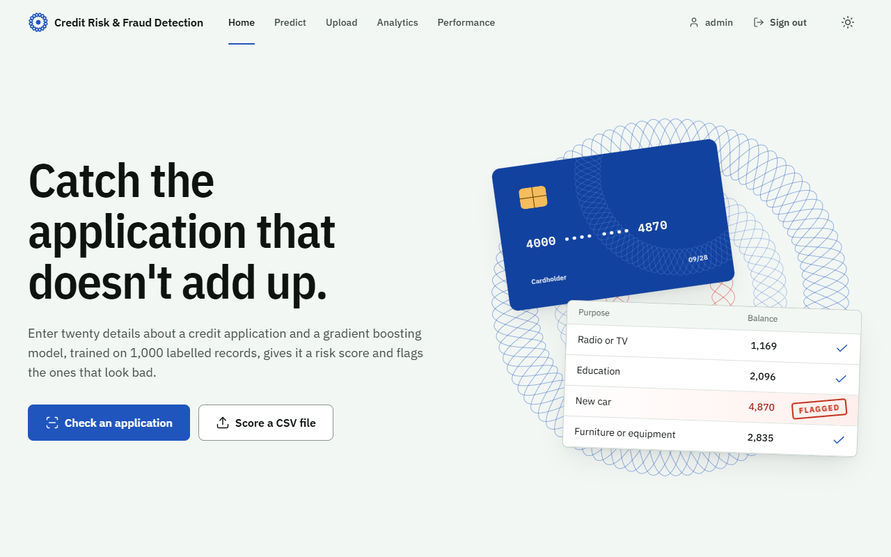
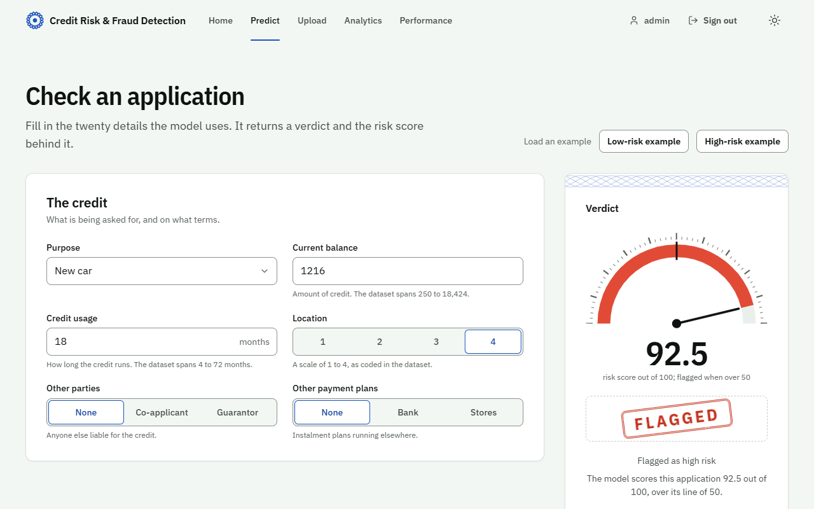
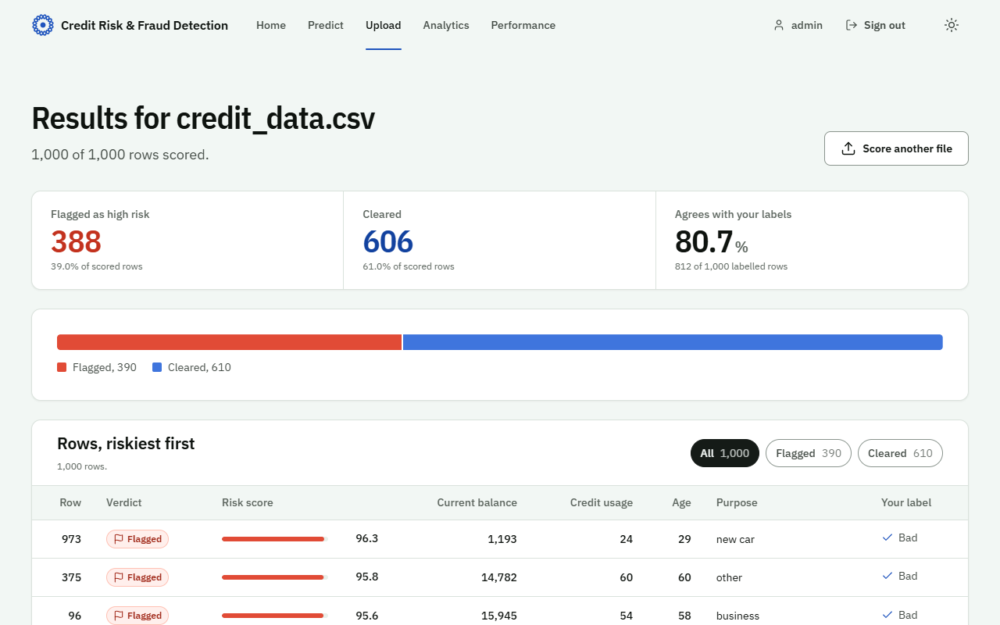
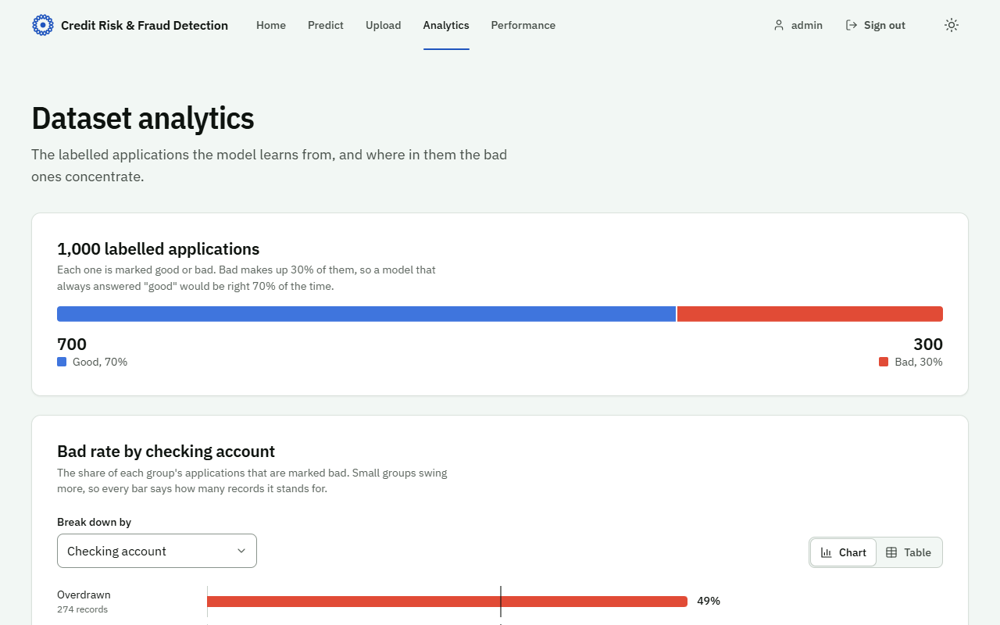
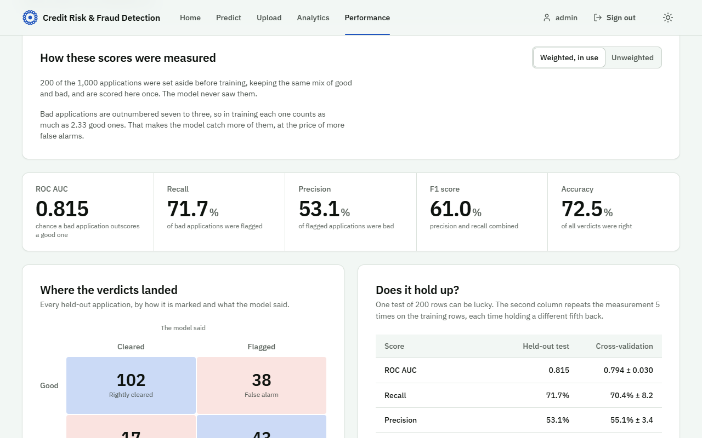

# Credit Risk & Fraud Detection System

[](https://github.com/sinchalkar001-dev/Credit-Card-Fraud-Detection/actions/workflows/ci.yml)

A Flask web app and REST API that scores credit applications for risk. A gradient boosting
classifier, trained on 1,000 labelled applications with 20 attributes each, gives every
application a risk score from 0 to 100 and flags it when the score is over 50. You can check one
application in a form, score a whole CSV file, explore where bad applications concentrate in the
data, and see how the model performs on applications it has never seen.

<picture>
  <source media="(prefers-color-scheme: dark)" srcset="docs/screenshots/home-dark.png">
  
</picture>

## Features

- **Single and batch scoring.** A form for one application, CSV upload for up to 10,000 rows, and
  the same two operations as JSON endpoints.
- **Honest evaluation.** A stratified test set is held out before anything else happens; settings
  are chosen by 5-fold cross-validation on the rest. Every score in the app and below is reproducible
  with one command.
- **Analytics dashboard.** The class balance of the data and the bad rate broken down by any of the
  20 inputs, as a chart or a table.
- **Session-based sign-in** with CSRF protection, safe redirects and a Content Security Policy.
- **Docker image and Compose file** with a health-check endpoint, served by gunicorn.
- **Tests** for the schema, validation, CSV handling, the model, the training protocol, every page
  and every endpoint, run by GitHub Actions on each push together with a Docker build.
- **A custom interface** with no front-end framework or CDN: a token-based design system,
  light and dark themes, motion that respects reduced-motion settings, and keyboard and screen-reader
  support.

| Check an application | Results of a batch |
| --- | --- |
|  |  |
| **Dataset analytics** | **Model performance** |
|  |  |

## Quick start

Needs Python 3.11 or newer.

```bash
git clone https://github.com/sinchalkar001-dev/Credit-Card-Fraud-Detection.git
cd Credit-Card-Fraud-Detection

python -m venv venv
# Windows:        venv\Scripts\activate
# macOS / Linux:  source venv/bin/activate

pip install -r requirements.txt
python main.py
```

Open <http://localhost:5000> and sign in with `admin` / `admin123`.

The first start trains the model, which takes about 15 seconds; later starts reuse it. To retrain on
purpose, for example after upgrading scikit-learn, run `python train_model.py`.

### With Docker

```bash
docker compose up --build
```

The image trains the model while it builds, then serves the app on <http://localhost:5000> with
gunicorn. Set `SECRET_KEY` and `ADMIN_PASSWORD` (in your shell or a `.env` file next to
`docker-compose.yml`) before exposing it anywhere.

## The model

| | |
| --- | --- |
| Algorithm | `GradientBoostingClassifier` (scikit-learn 1.8) |
| Data | 1,000 applications, 20 attributes, 700 good and 300 bad |
| Settings | 300 trees, depth 2, learning rate 0.05, subsample 0.8, chosen by 5-fold cross-validation |
| Imbalance | Each bad application weighted to count as much as 2.33 good ones |
| Strongest inputs | Checking account 22%, current balance 16%, credit usage 12% |

### How it is tested

1. 200 applications (20%) are set aside first, keeping the 70/30 mix. Nothing looks at them until the
   final scoring.
2. Tree depth, tree count and learning rate are chosen by 5-fold cross-validation on the other 800,
   by ROC AUC.
3. The model is fitted on the 800 and scored once on the 200.

Nothing is oversampled, so a held-out application can never be a copy of a training one. The notebook
this project started from oversampled the minority class *before* splitting, which put copies of 128
training rows into its 152-row "bad" test set and inflated its accuracy to 91%.

### Results

On the 200 held-out applications, and as the mean and spread of 5-fold cross-validation on the 800
training rows:

| | Held-out test | Cross-validation |
| --- | --- | --- |
| ROC AUC | **0.815** | 0.794 ± 0.030 |
| Recall (bad applications caught) | **71.7%** | 70.4% ± 8.2 |
| Precision (flags that were right) | 53.1% | 55.1% ± 3.4 |
| F1 score | 0.610 | 0.617 ± 0.050 |
| Accuracy | 72.5% | 74.0% ± 2.5 |
| Always answering "good" | 70.0% accuracy | 0.5 ROC AUC |

Confusion matrix on the held-out set: 102 good applications cleared, 38 false alarms, 43 bad
applications caught, 17 missed.

The class weighting is a deliberate trade. Fitted without it, the same model scores 80.0% accuracy
and 0.830 ROC AUC on the held-out set, but catches only 56.7% of bad applications (cross-validation:
45.8%). The dataset's own documentation treats a missed bad application as five times as costly as a
false alarm, so the app serves the weighted model. The Performance page shows both.

## Using the app

| Page | What it does |
| --- | --- |
| **Predict** | Fill in the 20 details (or load a worked example) and get a verdict, a risk score dial and an explanation. |
| **Upload** | Drop a CSV. Every row is scored; the results list the riskiest rows first and, if the file has a `class` column, how often the model agrees with it. A sample file is linked on the page. |
| **Analytics** | Class balance and the bad rate for each group of any input, against the overall rate. |
| **Performance** | The scores above, the confusion matrix, cross-validation, feature importance and the model's settings. Switch between the weighted and unweighted model. |

CSV files need a header row with the 20 columns listed on the Upload page (`over_draft`,
`credit_usage`, ... `foreign_worker`), in any order. Values can be written the way the dataset writes
them (`radio/tv`, `<100`, `existing paid`) or as the model's numeric codes. Other columns are ignored.
`data/sample_upload.csv` is a ready-made example.

## REST API

The API needs no sign-in.

| Method | Endpoint | Purpose |
| --- | --- | --- |
| GET | `/api/health` | Health check, used by Docker |
| POST | `/api/predict` | Score one application (JSON) |
| POST | `/api/predict-batch` | Score a CSV file (multipart, field `file`) |
| GET | `/api/model-info` | Inputs, allowed values, settings and test scores |

```bash
curl -X POST http://localhost:5000/api/predict \
  -H "Content-Type: application/json" \
  -d '{"over_draft": "<0", "credit_usage": 18, "credit_history": "delayed previously",
       "purpose": "new car", "current_balance": 1216, "average_credit_balance": "<100",
       "employment": "<1", "location": 4, "personal_status": "female div/dep/mar",
       "other_parties": "none", "residence_since": 3, "property_magnitude": "no known property",
       "cc_age": 23, "other_payment_plans": "none", "housing": "rent", "existing_credits": 1,
       "job": "skilled", "num_dependents": 1, "own_telephone": "yes", "foreign_worker": "yes"}'
```

```json
{"prediction": {"flagged": true, "prediction": "bad", "risk_score": 92.54364563441757}, "success": true}
```

A request with missing or unusable values gets a `400` that names each field and says what is wrong:

```json
{"error": "Some values are missing or cannot be used.",
 "fields": {"cc_age": "Age must be between 18 and 100 years.", "current_balance": "Enter current balance.", "...": "..."}}
```

```bash
curl -X POST http://localhost:5000/api/predict-batch -F "file=@data/sample_upload.csv"
```

returns one result per row, in file order: `{"row": 1, "prediction": {...}}`, or
`{"row": 7, "error": "..."}` for a row that could not be read.

## Project structure

```text
app/
  __init__.py          app factory: config, logging, security headers, error pages
  config.py            settings, read from environment variables
  models/fraud_model.py  loads the trained model and scores applications
  routes/              pages, sign-in, prediction, upload, and the JSON API
  utils/
    schema.py          the 20 inputs: order, labels, ranges and codes (single source of truth)
    validators.py      checks submitted values and files
    preprocessing.py   turns forms, JSON and CSV rows into model input
    insights.py        figures for the Analytics and Performance pages
    security.py        CSRF tokens, safe redirects, security headers
  templates/           Jinja templates
  static/              CSS (design tokens and components), JavaScript, fonts, images
data/
  credit_data.csv      the 1,000 labelled applications
  sample_upload.csv    12 rows to try the upload with
tests/                 unittest suite
tools/guilloche.py     draws the engraved line-work used in the interface
design-system/         the design system: tokens, components, motion
train_model.py         trains, tests and saves the model (model/ is generated, not committed)
main.py                local entry point
wsgi.py                production entry point (gunicorn)
Dockerfile, docker-compose.yml
```

## Configuration

Copy `.env.example` to `.env` to change any of these; `main.py` reads it on start.

| Variable | Default | Purpose |
| --- | --- | --- |
| `SECRET_KEY` | development value | Signs the session cookie. Set a long random value outside local use. |
| `ADMIN_USERNAME` / `ADMIN_PASSWORD` | `admin` / `admin123` | The analyst login. The sign-in page only shows them while they are the defaults. |
| `FLASK_ENV` | `development` | `production` turns on secure cookies. |
| `FLASK_DEBUG` | `False` | Reloader and in-browser debugger, for local work only. |
| `HOST` / `PORT` | `127.0.0.1` / `5000` | Where `main.py` listens. |
| `SESSION_COOKIE_SECURE` | `False` (`True` in production) | Only send the session cookie over HTTPS. |

## Tests

```bash
python -m unittest discover -s tests -t .
```

The first run trains the model if it is missing. The suite checks the feature schema against the
dataset, validation messages, CSV parsing (including Excel byte-order marks), that the recorded
scores are exactly what the saved model earns, that no held-out row appears in training, every page
and API response, and CSRF protection.

## Design

The interface borrows from security printing: the engraved guilloche line-work of banknotes and
cheques, ledger-paper neutrals, and two stamp inks, blue for a cleared application and red for a
flagged one. Type is IBM Plex Sans throughout. Colours, type, spacing and motion are design tokens in
`app/static/css/tokens.css`, in three layers (primitive, semantic, component), with light and dark
values side by side. Motion is limited to transforms, opacity and stroke drawing, and every animation
gives way to the final state when the system asks for reduced motion. Details are in
[design-system/credit-risk-fraud-detection/MASTER.md](design-system/credit-risk-fraud-detection/MASTER.md).

## Limitations

- 1,000 applications is a small dataset, so the scores move by a few points between test splits; the
  cross-validation spread shows by how much.
- The data includes age, sex and marital status, and foreign-worker status. Real lenders are barred
  from using these in many countries. This is a learning project, not a decision tool.
- There is one built-in analyst account and no user management.

## Acknowledgements

- The data is the Statlog (German Credit Data) set by Hans Hofmann, from the
  [UCI Machine Learning Repository](https://archive.ics.uci.edu/dataset/144/statlog+german+credit+data)
  (CC BY 4.0), in a copy with renamed columns.
- This project began from [Santhosh-k-dot/creadit_card_fraud_detection](https://github.com/Santhosh-k-dot/creadit_card_fraud_detection),
  which supplied the dataset file and the original notebook. The application, training pipeline,
  tests and interface here were written for this repository.
- IBM Plex fonts are © IBM Corp., under the SIL Open Font License (`app/static/fonts/OFL.txt`).

## License

MIT for the code in this repository; see [LICENSE](LICENSE).
